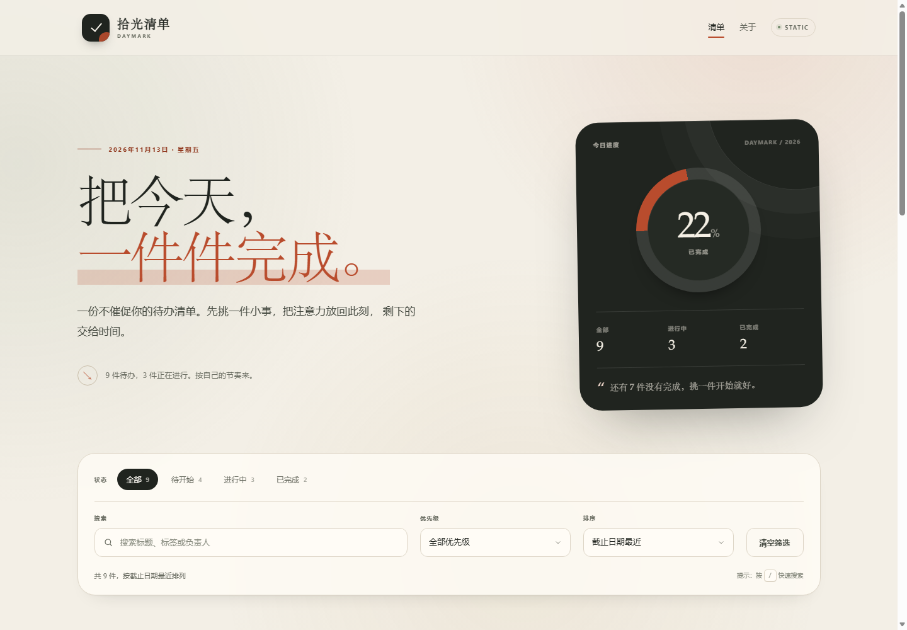
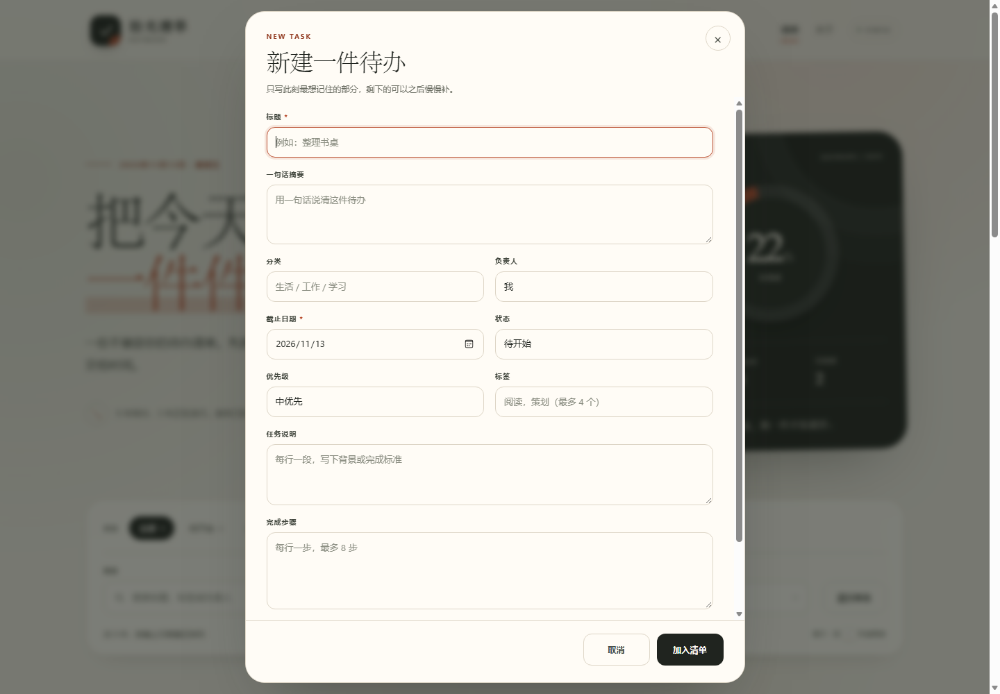
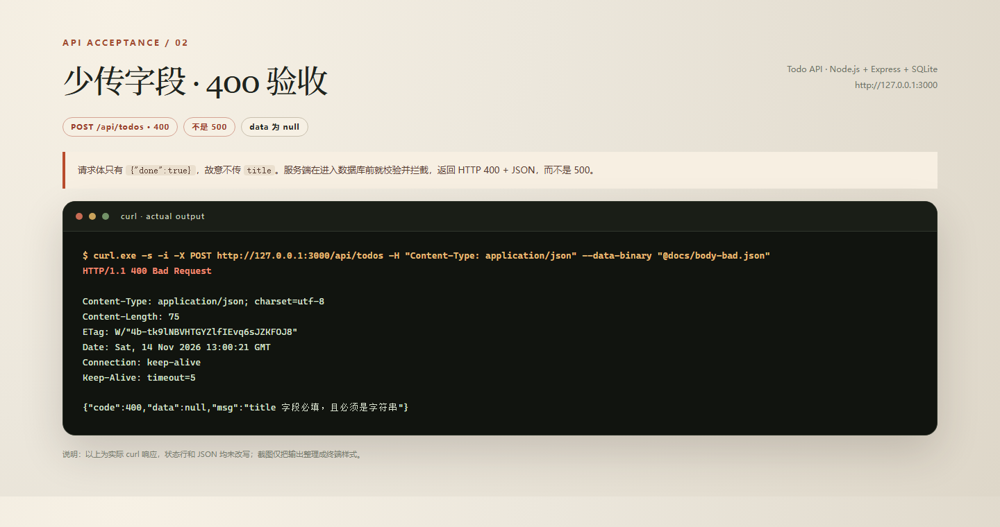
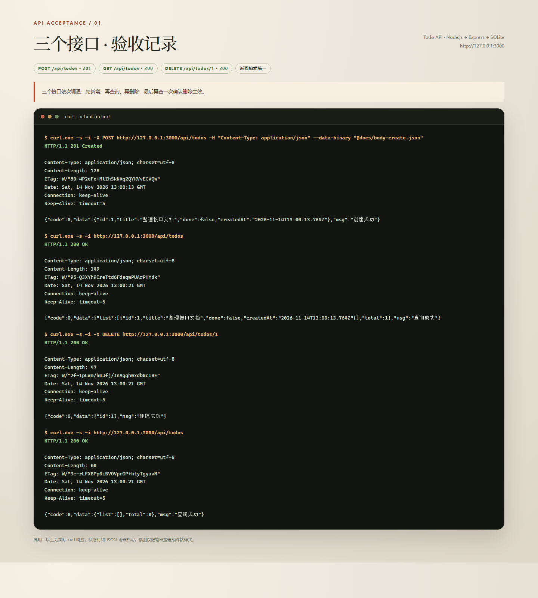
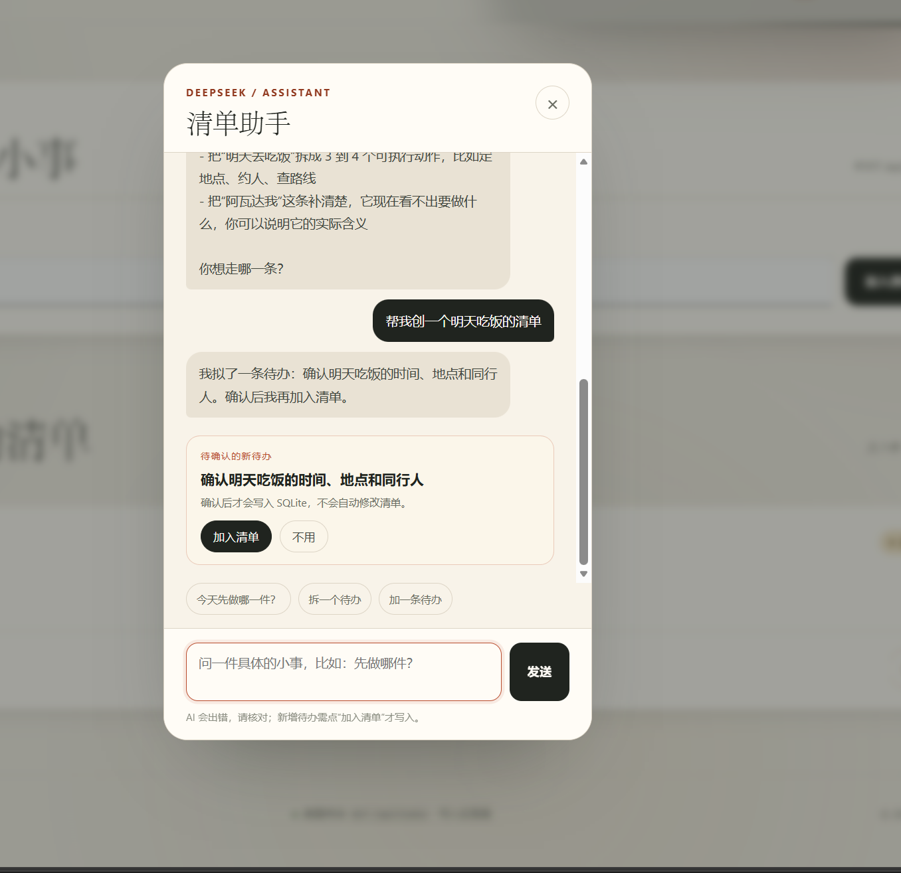
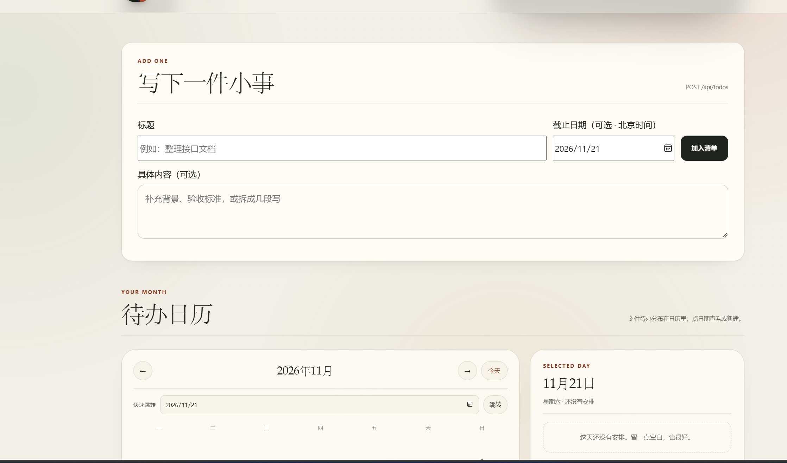

在线网址:http://115.29.213.6/api.html
我选择了待办清单这个项目，并成功创建了一个静态网页

第二阶段实现了接口搭建 

经过多次碰壁，例如服务器创建，代码出错，ai接入后无法正常创建新清单等问题，最终实现了要求

随后，我认为我的程序还不够完善，有所欠缺，比如看截止日期不够直观，增加新任务有些繁琐，因此，我加入了日历功能，通过日历可以直接看到哪天有任务，点击日历即可查看详细内容或者增加删除修改一个内容，经过这个优化，我觉得用户可以更加直观便捷的查询自己的待办清单，同时也能更真切的感受时间的紧迫，督促用户完成自己的任务，达到任务清单真的作用即作为一个备忘录便捷地帮助用户记录并督促用户行动。

